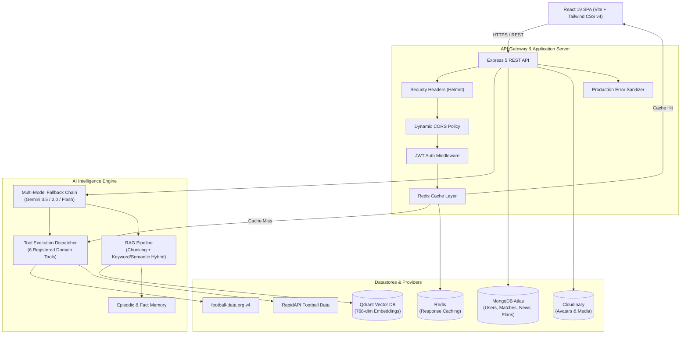

# ⚽ Football Copilot

> **The AI-Powered Operating System for Modern Football Tactics, Scouting, and Real-Time Analytics.**

[](https://react.dev/)
[](https://vitejs.dev/)
[](https://tailwindcss.com/)
[](https://nodejs.org/)
[](https://expressjs.com/)
[](https://www.mongodb.com/)
[](https://qdrant.tech/)
[](https://redis.io/)
[](https://ai.google.dev/)
[](https://www.docker.com/)

---

## 📌 Table of Contents

- [Overview](#-overview)
- [System Architecture](#-system-architecture)
- [Key Features](#-key-features)
- [Tech Stack](#-tech-stack)
- [API Integrations & Data Providers](#-api-integrations--data-providers)
- [Project Structure](#-project-structure)
- [Getting Started](#-getting-started)
  - [Prerequisites](#prerequisites)
  - [Docker Quickstart (Redis & Qdrant)](#docker-quickstart-redis--qdrant)
  - [Backend Setup](#backend-setup)
  - [Frontend Setup](#frontend-setup)
- [Environment Variables](#-environment-variables)
- [Automated Testing](#-automated-testing)
- [Deployment & Production Security](#-deployment--production-security)
- [Live Demo & Screenshots](#-live-demo--preview)
- [Contributing & License](#-license)

---

## 🌟 Overview

**Football Copilot** is a high-performance sports analytics platform and tactical operating system designed for coaches, analysts, scouts, and football enthusiasts. 

Rather than functioning as a standard livescore wrapper, Football Copilot couples **real-time football data streams** with an **autonomous AI analytics engine** powered by Google Gemini, Qdrant Vector DB (RAG), and a Bivariate Poisson probabilistic modeling pipeline.

### Highlights
- 🧠 **Context-Aware AI Copilot**: Multi-turn chat grounded in a custom knowledge base via Retrieval-Augmented Generation (RAG) and automated source citations.
- 🛠️ **Real-Time Tool Calling**: Autonomous tool execution for live matches, league tables, player profiles, and transfer records.
- 📐 **Probabilistic Modeling**: Mathematically sound Bivariate Poisson win probabilities incorporating European home advantage (+75 Elo) and goal expectancy.
- 📊 **Chance-Quality xG Engine**: Prioritizes official provider tracking data, falling back to a transparently labeled match-tempo chance model when official tracking is absent.
- 📋 **Tactical Planner Agent**: Generates structured tactical masterplans, training drill progressions, and in-game contingency checklists.
- ⚡ **Ultra-Fast & Resilient**: Multi-tier Redis caching, multi-model Gemini fallback chains, and sub-second vectorized semantic memory.

---

## 🏗️ System Architecture



---

## ⚡ Key Features

### 1. Tactical Match Center & Live Intel
- **Live Match Tracking**: Minute-by-minute elapsed time calculation, score progression, cards, and goal scorers.
- **Poisson Win Probability Model**: Validated pre-match win/draw/away probabilities modeling European home advantage (+75 Elo points) or official market odds without artificial character-code heuristics.
- **Expected Goals (xG)**: Displays official provider xG where available, or calibrated match-progress chance-quality estimates clearly tagged as `(Demo Est.)`.
- **AI Match Timeline & Tactical Summaries**: Automatic markdown summaries breaking down key turning points, defensive shapes, and standout performers.

### 2. Conversational Football Copilot (AI Engine)
- **Autonomous Tool Calling**: Gemini automatically invokes backend tools to fetch live match status, standings, player cards, and transfer history.
- **RAG Knowledge Base**: Ingests, chunks, and vectorizes tactical articles, scouting metrics (xG, xA, field tilt, progressive passes), and rulebooks with citation footnotes format `[Doc: "<Title>", Chunk #<Index>]`.
- **User Memory & Episodic Recall**: Stores tactical preferences and favorite teams in Qdrant vector space, injecting personalized context into subsequent conversations.
- **Multi-Model Fault Tolerance**: If Google Gemini encounters rate limits (429) or high traffic (503), requests automatically switch to fallback models (`gemini-3.5-flash-lite`, `gemini-2.5-flash-lite`) with exponential backoff.

### 3. Tactical Masterplan Planner
- **Agentic Blueprint Generator**: Generates 4-phase strategic plans (e.g. Breaking Down 5-4-1 Low Blocks, Pre-Match Blueprint against Manchester City).
- **Interactive Checklists**: Interactive milestone tasks with persistent completion state and category tags.

### 4. Scouting & Transfer Hub
- **Player Radar Attributes**: Dynamic Recharts polygon radar charts comparing physical, technical, and tactical parameters.
- **Live Transfer Index**: Formatted market valuations, loan indicators, and fee calculations.

### 5. UI/UX Design System
- Built with **React 19**, **Tailwind CSS v4**, and **Framer Motion**.
- Dark/Light mode toggle with instant theme token switching.
- Responsive mobile drawer navigation, keyboard shortcuts, and toast alerts via **Sonner**.

---

## 💻 Tech Stack

### Frontend
| Technology | Description |
|---|---|
| **React 19** | Latest concurrent UI library |
| **Vite 6** | Lightning-fast module bundler |
| **Tailwind CSS v4** | Modern utility-first CSS using `@theme` tokens |
| **React Router v7** | Single-page application routing |
| **TanStack Query v5** | Server state caching and background refetching |
| **Framer Motion 11** | Spring-based layout animations & transitions |
| **Recharts** | Interactive SVG charts & radar analytics |
| **Lucide React** | Clean sports & interface icons |
| **Sonner** | Accessible toast notification system |

### Backend
| Technology | Description |
|---|---|
| **Node.js 20+** | JavaScript runtime environment |
| **Express 5** | High-throughput HTTP API framework |
| **MongoDB & Mongoose 9** | NoSQL document database |
| **Qdrant Vector DB** | High-performance vector database for RAG & embeddings |
| **Redis** | In-memory cache for API rate absorption |
| **Google Gen AI SDK** | Gemini 2.0 / 3.5 / 3.8 generative models & embeddings |
| **Helmet & CORS** | Security headers and origin control |
| **Winston** | Multi-transport structured JSON logger |
| **Zod** | Runtime request body schema validation |

---

## 🌐 API Integrations & Data Providers

| Service | Purpose | Fallback / Redundancy |
|---|---|---|
| **Google Gemini API** | Natural language reasoning, RAG answers, and tool calling | Multi-model fallback chain (`gemini-3.5-flash-lite`, `gemini-2.0-flash`) |
| **Qdrant Vector DB** | Storing 768-dimensional text embeddings for semantic search | In-memory cosine similarity + keyword search fallback |
| **football-data.org (v4)** | Top-5 European leagues, standings, matchdays, and scorers | In-memory cached mock data |
| **RapidAPI Live Football** | Search indices for global players, teams, and transfers | Graceful empty-state fallbacks |
| **Cloudinary** | Secure media uploads for user avatars and match assets | Local placeholder avatars |
| **Redis** | Caches high-frequency endpoint responses | Continues seamlessly if Redis connection drops |

---

## 📁 Project Structure

```text
football-copilot/
├── backend/
│   ├── config/             # DB, Logger, Redis, and Qdrant clients
│   ├── controller/         # Request handling & HTTP response logic
│   ├── middleware/         # Auth, Cache, Validation, and Production Error Handler
│   ├── models/             # Mongoose schemas (Users, Plans, Knowledge, Matches)
│   ├── routes/             # REST endpoint routing definitions
│   ├── services/           # Business logic (AI, Football, RAG, Memory, Planner)
│   ├── tests/              # Native Node.js automated test suites
│   ├── utils/              # Chunker, Poisson model, API response helpers
│   ├── .env.example        # Environment variable template
│   ├── Dockerfile          # Production container recipe
│   └── package.json        # Dependencies & test scripts
│
├── frontend/
│   ├── src/
│   │   ├── components/     # UI atoms & football-specific cards
│   │   ├── constants/      # Fallback mocks & seed data
│   │   ├── context/        # Auth, Theme, and App state context
│   │   ├── pages/          # Views (Dashboard, Live, Fixtures, AI Chat, Scouting)
│   │   ├── routes/         # Application router configuration
│   │   ├── services/       # Axios API client wrapper
│   │   └── styles/         # Global styles & Tailwind v4 token themes
│   ├── .env.example        # Frontend environment variable template
│   └── package.json        # Frontend dependencies & Vite scripts
│
├── docker-compose.yml      # Multi-container orchestration (Redis + Qdrant + Backend)
├── .gitignore              # Repository-wide exclusion rules
└── README.md               # Root documentation
```

---

## 🚀 Getting Started

### Prerequisites
- **Node.js**: `v20.x` or higher
- **npm**: `v10.x` or higher
- **Docker & Docker Compose** (optional, recommended for local Redis & Qdrant)
- **MongoDB**: Local MongoDB instance or free [MongoDB Atlas](https://www.mongodb.com/) cluster

---

### Docker Quickstart (Redis & Qdrant)

Start local Redis and Qdrant instances with persistent volumes:
```bash
docker-compose up -d redis qdrant
```
- Qdrant Web Dashboard: [http://localhost:6333/dashboard](http://localhost:6333/dashboard)
- Redis Port: `localhost:6379`

---

### Backend Setup

1. **Navigate to backend**:
   ```bash
   cd backend
   ```

2. **Install dependencies**:
   ```bash
   npm install
   ```

3. **Configure Environment Variables**:
   Copy the template and supply your API keys:
   ```bash
   cp .env.example .env
   ```
   *(See the [Environment Variables](#-environment-variables) section for configuration options).*

4. **Launch development server**:
   ```bash
   npm run dev
   ```
   The backend API will start on `http://localhost:5000`.

---

### Frontend Setup

1. **Navigate to frontend**:
   ```bash
   cd frontend
   ```

2. **Install dependencies**:
   ```bash
   npm install
   ```

3. **Configure Environment Variables**:
   ```bash
   cp .env.example .env
   ```
   Ensure `VITE_API_BASE_URL` points to your backend:
   ```env
   VITE_API_BASE_URL=http://localhost:5000/api/v1
   ```

4. **Start Vite development server**:
   ```bash
   npm run dev
   ```
   Open [http://localhost:5173](http://localhost:5173) in your browser.

---

## 🔐 Environment Variables

### Backend (`backend/.env`)

| Variable | Description | Example / Default |
|---|---|---|
| `PORT` | Backend server port | `5000` |
| `NODE_ENV` | Application environment (`development`, `staging`, `production`) | `development` |
| `CLIENT_URL` | Allowed frontend origin for CORS (supports comma-separated list) | `http://localhost:5173` |
| `ALLOWED_ORIGINS` | Additional allowed origins for production | `https://footballcopilot.com` |
| `MONGO_URI` | MongoDB connection string | `mongodb://localhost:27017/football-copilot` |
| `JWT_SECRET` | Secret key for access token signing | `your_jwt_secret` |
| `JWT_REFRESH_SECRET` | Secret key for refresh token signing | `your_refresh_secret` |
| `FOOTBALL_DATA_API_KEY` | API token from football-data.org (v4) | `your_api_token` |
| `RAPID_API_KEY` | API key from RapidAPI | `your_rapid_api_key` |
| `RAPID_API_HOST` | RapidAPI host | `free-api-live-football-data.p.rapidapi.com` |
| `GEMINI_API_KEY` | Google Gemini API key | `your_gemini_api_key` |
| `GEMINI_MODEL` | Primary generative Gemini model | `gemini-2.0-flash` |
| `GEMINI_LITE_MODEL` | Fallback lightweight Gemini model | `gemini-2.0-flash-lite` |
| `QDRANT_URL` | Qdrant vector database URL | `http://localhost:6333` |
| `QDRANT_API_KEY` | Qdrant API key (leave empty for local instance) | *(empty)* |
| `REDIS_URL` | Redis cache connection URL | `redis://localhost:6379` |
| `CLOUDINARY_CLOUD_NAME` | Cloudinary cloud account name | `your_cloud_name` |
| `CLOUDINARY_API_KEY` | Cloudinary public API key | `your_cloudinary_key` |
| `CLOUDINARY_API_SECRET` | Cloudinary private API secret | `your_cloudinary_secret` |

### Frontend (`frontend/.env`)

| Variable | Description | Default |
|---|---|---|
| `VITE_API_BASE_URL` | Base URL of backend REST API | `http://localhost:5000/api/v1` |
| `VITE_SOCKET_URL` | Optional real-time socket endpoint | `http://localhost:5000` |

---

## 🧪 Automated Testing

The backend includes a zero-dependency automated test suite utilizing Node.js's native test runner (`node:test` and `node:assert/strict`).

Run all test suites:
```bash
cd backend
npm test
```

Run specialized test targets:
```bash
# Run tests with live watch mode
npm run test:watch

# Unit tests: Poisson model, Elo lookup, xG resolution, and Zod auth schemas
npm run test:unit

# Integration tests: HTTP routes, Helmet security headers, 401 gates, and CORS
npm run test:integration

# AI chat flow verification: Tool calling, RAG retrieval, context injection, and fallbacks
npm run test:ai
```

---

## 🛡️ Deployment & Production Security

1. **Production Error Masking**:
   When `NODE_ENV=production`, internal unhandled 500 errors automatically mask internal database queries, file paths, and stack traces from public responses, returning a clean error payload while logging the full trace to Winston.
2. **CORS Security**:
   Non-whitelisted cross-origin requests are rejected with `403 Forbidden`. Local development origins are ignored in production unless explicitly defined in `CLIENT_URL` or `ALLOWED_ORIGINS`.
3. **Containerized Deployment**:
   Build and run the entire application via Docker:
   ```bash
   docker-compose up --build -d
   ```
4. **Secrets Integrity**:
   `.env` and sensitive key files are excluded by root, backend, and frontend `.gitignore` rules. Never commit your `.env` to public version control.

---

## 🎬 Live Demo & Preview

- **Live Application**: [https://football-copilot.onrender.com](https://football-copilot.onrender.com)
- **Repository**: [https://github.com/vivekvagadiya/football-copilot.git](https://github.com/vivekvagadiya/football-copilot.git)

---

## 📄 License

This project is licensed under the [MIT License](LICENSE).
Built with passion for the beautiful game ⚽.
